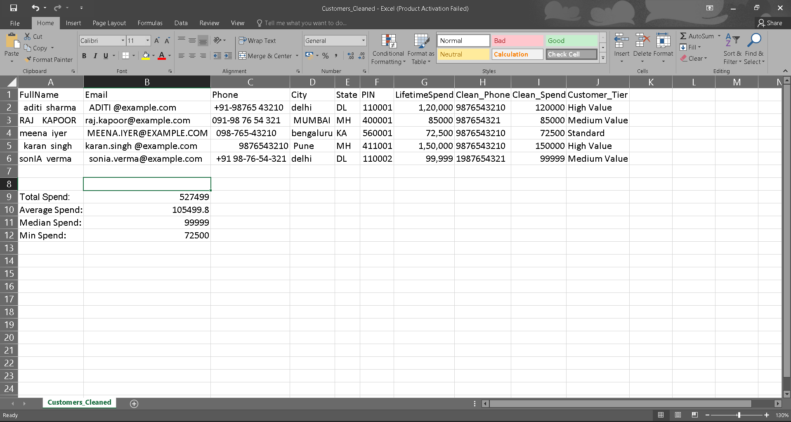

# 05 - Excel Intelligence

Data cleaning, customer tier segmentation, and summary KPIs for `Customers_Messy.csv`, documented via visual summary screenshots rather than raw binary `.xlsx` files.

## Data Cleaning Steps
- **Names & Cities:** Normalized casing and removed extra whitespace using `TRIM` and `PROPER`.
- **Emails:** Stripped spaces and standardized casing using `LOWER(SUBSTITUTE(TRIM(...)," ",""))`.
- **Phone Numbers (`Clean_Phone`):** Removed prefixes (`+91`, `091`), spaces, and hyphens to standardize contact numbers.
- **Lifetime Spend (`Clean_Spend`):** Removed commas and converted text values to numbers using `VALUE(SUBSTITUTE(...,",",""))`.
- **Corrupt Row Removal:** Removed the invalid/incomplete row containing `bad.email@@example..com` and `indecipherable`.

## Segmentation & Summary KPIs (n = 5 Valid Customers)
- **Customer Tier (`Customer_Tier`):** Segmented customers via `IF` logic into `High Value` (> 100,000), `Medium Value` (80,000–100,000), and `Standard` (< 80,000).
- **Total Spend:** `527,499`
- **Average Spend:** `105,499.80`
- **Median Spend:** `99,999.00`
- **Spend Range:** `72,500` (Min) to `150,000` (Max)
- **Standard Deviation:** `30,536.91`

## Visual Preview
